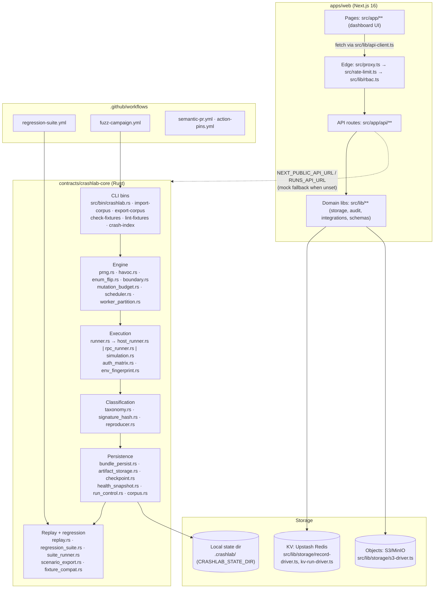
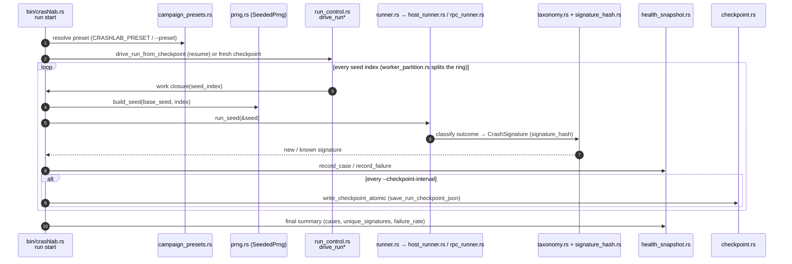
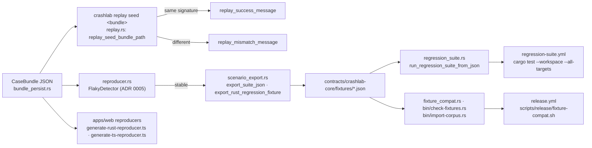
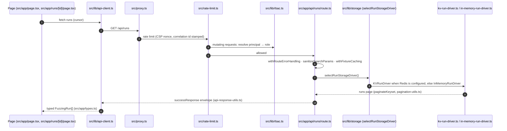

# Contributor architecture guide

A map of the repository for people about to change it: what the parts are,
where a seed's result travels, and what you can change without fallout in
the other stack. Every path below is real and is checked by
[`scripts/check-doc-links.mjs`](../../scripts/check-doc-links.mjs) in CI.

Next: [where to start](where-to-start.md) (issue batch map, labels, workflow).
Background: [ARCHITECTURE.md](../ARCHITECTURE.md), the
[ADR index](../adr/README.md).

## Component map

### Boundaries: what you can change without cross-stack fallout

| You change | Safe to do alone | Needs the other stack (or an ADR) |
|---|---|---|
| A mutator, scheduler or runner internals in `crashlab-core` | Yes, if replay of existing fixtures is unchanged | Anything that changes the seed sequence or replay outcome — engine surface in the [release policy](../releases/policy.md#surfaces) |
| `taxonomy.rs` / `signature_hash.rs` | No | Re-buckets every stored crash; the web cluster views and stored signatures move with it |
| `bundle_persist.rs` schema (`CASE_BUNDLE_SCHEMA_VERSION`) | No | Web types in [`apps/web/src/app/types.ts`](../../apps/web/src/app/types.ts) and N-1 readers (ADR 0007 drift risk) |
| An API route's response shape | Additive fields only | Removing/renaming fields breaks [`openapi.json`](../../apps/web/src/lib/openapi/openapi.json) consumers |
| A page or component under `apps/web/src/app` | Yes | — |
| `src/proxy.ts`, `src/rate-limit.ts`, `src/lib/rbac.ts` | Rarely — every API request passes through them | Security review; see [SECURITY.md](../../SECURITY.md) |
| A workflow under `.github/workflows` | Yes, with actions pinned to SHAs (`action-pins.yml`) | Required checks: talk to a maintainer first |

## (a) Campaign execution and failure capture

How one seed becomes a recorded failure. Entry point:
`crashlab run start` in [`src/bin/crashlab.rs`](../../contracts/crashlab-core/src/bin/crashlab.rs)
(`run_start_command`).

Failures worth keeping become `CaseBundle`s (`to_bundle*` in
[`lib.rs`](../../contracts/crashlab-core/src/lib.rs), serialized by
[`bundle_persist.rs`](../../contracts/crashlab-core/src/bundle_persist.rs)) and are
stored through the `ArtifactStore` trait
([`artifact_storage.rs`](../../contracts/crashlab-core/src/artifact_storage.rs), ADR 0006).
Cancellation is cooperative ([`run_control.rs`](../../contracts/crashlab-core/src/run_control.rs),
ADR 0008); auth-mode divergence comes from
[`auth_matrix.rs`](../../contracts/crashlab-core/src/auth_matrix.rs) (ADR 0003).

## (b) Replay and regression pipeline

How a stored failure becomes a regression test and stays honest.

Key files: [`replay.rs`](../../contracts/crashlab-core/src/replay.rs),
[`reproducer.rs`](../../contracts/crashlab-core/src/reproducer.rs),
[`scenario_export.rs`](../../contracts/crashlab-core/src/scenario_export.rs),
[`regression_suite.rs`](../../contracts/crashlab-core/src/regression_suite.rs),
[`fixture_compat.rs`](../../contracts/crashlab-core/src/fixture_compat.rs),
[`fixtures/`](../../contracts/crashlab-core/fixtures/),
[`regression-suite.yml`](../../.github/workflows/regression-suite.yml),
[`fixture-compat.sh`](../../scripts/release/fixture-compat.sh).
Determinism guarantees: ADR 0002 and [REPRODUCIBILITY.md](../REPRODUCIBILITY.md).

## (c) Dashboard request path

What happens between a click and a row on screen, e.g. the runs table.

Key files: [`proxy.ts`](../../apps/web/src/proxy.ts),
[`rate-limit.ts`](../../apps/web/src/rate-limit.ts),
[`rbac.ts`](../../apps/web/src/lib/rbac.ts),
[`api/runs/route.ts`](../../apps/web/src/app/api/runs/route.ts),
[`route-handler.ts`](../../apps/web/src/lib/route-handler.ts),
[`storage/index.ts`](../../apps/web/src/lib/storage/index.ts),
[`kv-run-driver.ts`](../../apps/web/src/lib/storage/kv-run-driver.ts),
[`pagination-utils.ts`](../../apps/web/src/app/pagination-utils.ts),
[`api-response-utils.ts`](../../apps/web/src/lib/api-response-utils.ts),
[`api-client.ts`](../../apps/web/src/lib/api-client.ts).

The UI does not wait to discover authorization from a 403. Before rendering a
gated control, pages read the caller's role from
[`api/settings/roles/me`](../../apps/web/src/app/api/settings/roles/me/route.ts)
through [`permissions.ts`](../../apps/web/src/lib/permissions.ts), whose
capability registry derives each required role from the same
[`route-catalog.ts`](../../apps/web/src/lib/route-catalog.ts) the proxy
authorizes against. [`Can`](../../apps/web/src/components/Can.tsx) disables or
hides a control with a linked explanation, and
[`RequireCapability`](../../apps/web/src/components/RequireCapability.tsx)
redirects unauthorized deep links to the
[`/403`](../../apps/web/src/app/403/page.tsx) recovery page. This mirror is
advisory only — the server remains the enforcer. See
[ADR-0012](../adr/0012-capability-driven-ui-gating.md).
Live updates for a run stream over
[`api/runs/[id]/stream`](../../apps/web/src/app/api/runs/[id]/stream) via
[`run-stream.ts`](../../apps/web/src/lib/run-stream.ts). With no backend
configured the routes serve mock data (ADR 0007).

## Diagram sources

The diagrams are Mermaid, inline in this file, so GitHub renders them and a
diff shows every change. Update them in the same PR as the code they describe;
the link check keeps the file references honest.
