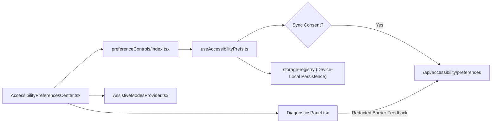

# Frontend: Accessibility Preferences & Assistive Diagnostics Center (#2317)

## Overview

The **Accessibility Preferences & Assistive Diagnostics Center** (`/settings/accessibility`) delivers comprehensive visual, motion, cognitive, spacing/density, and interaction personalization alongside per-surface assistive alternatives for complex visualizations and an in-app WCAG 2.2 diagnostics & barrier-reporting loop.

## Architecture

## Module Map

| Path | Purpose |
| --- | --- |
| `apps/web/src/features/accessibility/AccessibilityPreferencesCenter.tsx` | Main shell combining workspace profile switcher, consent toggle, preference controls, live assistive chart preview, shortcut guide, and diagnostics panel |
| `apps/web/src/features/accessibility/preferenceControls/index.tsx` | Personalization radio groups and toggles: reduced motion, text scaling (`100%..150%`), high contrast, line height, layout density, focus ring visibility, pointer target size, keyboard navigation mode, and complex-view assistive toggles |
| `apps/web/src/features/accessibility/AssistiveModesProvider.tsx` | Context provider and assistive visualization engine (`buildAssistiveChartSummary`, `getPatternShapeLabel`, `AssistiveVisualizationPreview`) rendering natural-language summaries, non-colour hatch patterns, and accessible HTML data-table alternatives |
| `apps/web/src/features/accessibility/DiagnosticsPanel.tsx` | In-app diagnostics inspector (`computeContrastRatio`, `validateHeadingLevels`, `runLiveDomDiagnostics`) auditing focus traversal order, missing labels, landmarks/headings, and token contrast ratios, plus privacy-safe barrier feedback intake |
| `apps/web/src/features/accessibility/hooks/useAccessibilityPrefs.ts` | Global & per-workspace preference state hook with immediate DOM application (`applyAccessibilityPrefsToDocument`) and consent-gated server persistence |
| `apps/web/src/app/api/accessibility/preferences/route.ts` | REST endpoint (`GET`, `PUT`, `POST`, `DELETE`) enforcing opt-in consent before storing assistive preferences and redacting personal data from barrier reports |
| `apps/web/src/app/settings/accessibility/page.tsx` | `/settings/accessibility` route integration |

## Personalization & WCAG 2.2 Alignment

- **Motion (`WCAG 2.3.3`)**: `system | reduced | full` applied via `data-motion="reduced"` pre-paint and at runtime.
- **Text Scaling (`WCAG 1.4.4`)**: `100% | 112% | 125% | 150%` root font scaling without breaking layout reflow.
- **Contrast (`WCAG 1.4.3 / 1.4.11`)**: `standard | high` high-contrast token set toggled on `document.documentElement`.
- **Line Height & Density (`WCAG 1.4.12`)**: `normal (1.5x) | relaxed (1.75x) | spacious (2.0x)` and `compact | comfortable | spacious` layout density via `data-line-height` and `data-density`.
- **Focus Indicators & Pointer Targets (`WCAG 2.4.11 / 2.5.8`)**: `default | enhanced | high-visibility` focus rings (`data-focus-indicator`) and `standard (24px+) | large (44px+)` pointer hit targets (`data-pointer-target`).
- **Keyboard Behavior (`WCAG 2.1.1`)**: `standard | enhanced-shortcuts | roving-grid` (`data-keyboard-nav`).

## Assistive Alternatives for Complex Views

1. **Data Table Alternatives (`chartDataTableAlternative`)**: Replaces or pairs visual charts with semantic `<table>`, `<caption>`, and `<th scope="col|row">` markup.
2. **Natural-Language Summary Descriptions (`autoSummaryDescriptions`)**: Deterministic summary generator reporting series count, peak, minimum, and mean values.
3. **Pattern & Shape Encoding (`patternShapeEncoding`)**: Pairs colour series with geometric symbols (`● Solid`, `▲ Hatched`, `■ Dotted`, `◆ Crosshatch`) and diagonal hatch overlays so information is never conveyed by colour alone (`WCAG 1.4.1`).
4. **Simplified Dense Layouts (`simplifiedDenseLayout`)**: Reduces secondary telemetry columns during high-volume triage.

## Privacy & Security Guarantees

- **No Tracking Without Consent**: Preferences are persisted locally via `accessibilityPrefsStore` and `workspaceAccessibilityPrefsStore`. The `/api/accessibility/preferences` endpoint refuses to persist assistive profiles unless `consent: true` is explicitly set, deleting any prior server record when consent is revoked.
- **Redacted Barrier Feedback**: Barrier reports submitted through `DiagnosticsPanel` strip emails, query tokens/keys/sessions, and 9+ digit sequences via `redactPersonalData` before storage.
