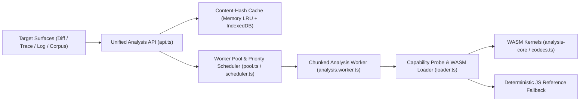

# Frontend: Client-Side WASM Analysis Engine (#2318)

## Overview

The **Client-Side WASM Analysis Engine** offloads CPU-intensive trace normalization, structural state diffing, entropy and security signature scanning, log query analysis, and corpus deduplication from the main thread and server round-trips into an in-browser WebAssembly + Worker execution layer.

It guarantees deterministic outputs across browsers and environments, supports air-gapped/offline investigative workflows, and provides a schema-validated fallback to pure TypeScript reference kernels when WebAssembly or Web Workers are constrained by runtime policy.

## Architecture



## Module Map

| Path | Purpose |
| --- | --- |
| `apps/web/src/lib/analysis-engine/wasm/types.ts` | Zod I/O schemas, operation contracts, error types (`AnalysisEngineError`), capability and telemetry interfaces |
| `apps/web/src/lib/analysis-engine/wasm/loader.ts` | Runtime capability probe (`detectWasmCapabilities`), embedded WASM binary instantiation, linear memory OOM budget guard, and telemetry hooks |
| `apps/web/src/lib/analysis-engine/wasm/codecs.ts` | Core deterministic kernels: trace normalization, structural diffing, entropy & Soroban security signature scanning, summary statistics, log query analysis, and corpus deduplication |
| `apps/web/src/lib/analysis-engine/workers/scheduler.ts` | Priority task queue (`critical`, `high`, `normal`, `low`) with FIFO tie-breaking, backpressure limits, and `AbortSignal` cancellation |
| `apps/web/src/lib/analysis-engine/workers/analysis.worker.ts` | Chunked execution engine emitting progressive `AnalysisStreamChunk` updates with cooperative event-loop yielding |
| `apps/web/src/lib/analysis-engine/workers/pool.ts` | Bounded worker pool (`AnalysisWorkerPool`) with concurrency limits, cancellation propagation, and utilization metrics |
| `apps/web/src/lib/analysis-engine/cache.ts` | Two-tier derived-artifact cache (in-memory LRU + IndexedDB persistence) keyed and invalidated by 64-bit content hash and schema version |
| `apps/web/src/lib/analysis-engine/api.ts` | High-level bindings (`analyzeTraceNormalization`, `analyzeRunDiff`, `analyzeEntropyAndSecurity`, `analyzeSummaryStatistics`, `analyzeLogQuery`, `analyzeCorpus`) and the Golden Parity Harness (`runGoldenParityHarness`) |
| `apps/web/wasm/analysis-core/` | `#![no_std]` Rust crate source (`Cargo.toml`, `src/lib.rs`) for the low-level WASM linear memory exports (`fnv1a32`, `count_byte_value`, `count_ascii_printable`, `xor_checksum`) |

## Core Kernels

1. **Trace & Event Normalization (`normalize_trace`)**: Sorts out-of-order trace events by sequence, canonicalizes nested payloads with recursive key sorting, computes per-event 64-bit FNV-1a digests, and derives call duration summary statistics.
2. **Structural State & Trace Diff (`compute_diff`)**: Compares before/after ledger state payloads key-by-key regardless of property order, categorizes entries (`created`, `updated`, `deleted`, `unchanged`), and pinpoints first trace divergence with heuristic confidence scoring.
3. **Entropy & Security Pattern Scan (`scan_entropy`)**: Computes Shannon byte entropy ($0..8$ bits/byte), ASCII printable ratios, zero-byte density via WASM linear memory exports, and scans against deterministic Soroban security signatures (`SEC-SOROBAN-AUTH-BYPASS`, `SEC-SOROBAN-REENTRANCY`, `SEC-SOROBAN-ARITH-OVERFLOW`, `SEC-SOROBAN-BUDGET-EXHAUSTED`, `SEC-SOROBAN-STORAGE-COLLISION`, `SEC-SECRET-LEAK-TOKEN`, `SEC-WASM-UNREACHABLE-TRAP`).
4. **Summary Statistics (`compute_summary`)**: Computes deterministic count, sum, mean, min, max, population variance, standard deviation, and Type-7 linear-interpolated quantiles (`p50`, `p90`, `p95`, `p99`) rounded to 4 decimal places.
5. **Log Query & Insights (`analyze_logs`)**: Filters structured logs by severity and search query, aggregates top emitting sources, and extracts matching security signatures.
6. **Corpus & Coverage Analysis (`analyze_corpus`)**: Computes seed signature hashes to identify duplicate corpus inputs, calculates redundancy ratios, summarizes coverage and byte size distributions, and ranks hot contracts by crash count and peak coverage.

## Caching & Content-Hash Invalidation

Derived artifacts are cached under deterministic keys of the form:

```text
v1:<operation>:<64-bit-content-hash>
```

- **Memory Tier**: Synchronous LRU map (default 128 entries) for zero-latency repeated queries within an active investigation session.
- **IndexedDB Tier**: Persistent browser store (`crashlab_wasm_analysis_cache`) for cross-reload reuse on large traces and corpus snapshots.
- **Invalidation**: Automatic on input mutation (content hash change), TTL expiration, or explicit `cache.invalidateByHash(hash)` / `cache.invalidateOperation(op)`.

## Security, Memory Safety & Fallback Guarantees

- **Strict CSP Compatibility**: No `eval` or `new Function()` is ever invoked.
- **Memory Budgets & Explicit OOM UX**: Every kernel checks `enforceMemoryBudget` before allocation. Inputs exceeding the budget throw `AnalysisEngineError('OOM_LIMIT_EXCEEDED', ...)` with actionable guidance and emit an `oom_guard_tripped` telemetry event.
- **Parity Validation**: `runGoldenParityHarness()` verifies that native WebAssembly execution and the pure TypeScript fallback produce bit-identical canonical JSON and content digests across all golden datasets.
