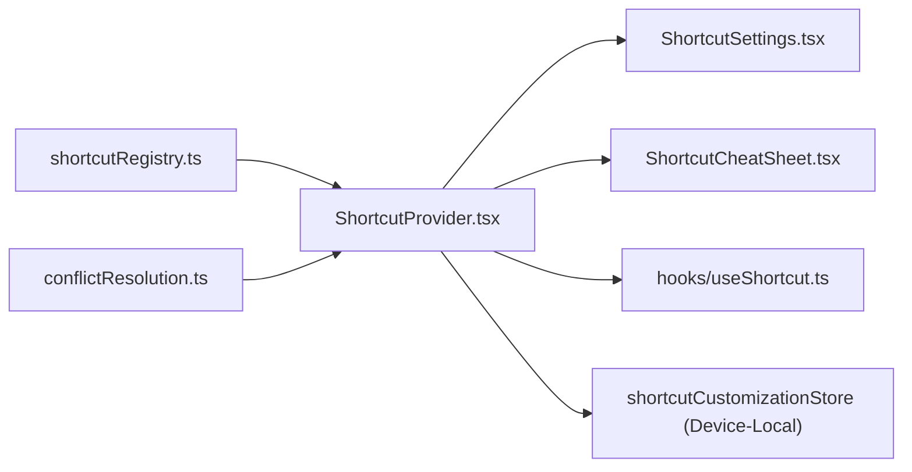

# Frontend: Keyboard Shortcuts & Power-User Customization Center (#2315)

## Overview

The **Keyboard Shortcuts & Power-User Customization Center** (`/settings/shortcuts`) provides a centralized command and shortcut registry with deterministic scope precedence, live conflict detection against browser/OS reserved bindings, audit-safe privileged action confirmation, portable JSON import/export, and explicit non-keyboard UI alternatives across every CrashLab surface.

## Architecture

## Module Map

| Path | Purpose |
| --- | --- |
| `apps/web/src/features/shortcuts/shortcutRegistry.ts` | Canonical command catalog (`DEFAULT_SHORTCUT_CATALOG`), context scope precedence (`modal > component > page > global`), surface tags (`global_shell`, `run_workspace`, `diff`, `trace`, `logs`, `tables`, `canvas`), chord normalizer (`normalizeKeyCombo`), platform formatter (`formatShortcutForPlatform`), and deterministic matcher (`matchShortcutCommandForKey`) |
| `apps/web/src/features/shortcuts/conflictResolution.ts` | Conflict and safety engine (`validateProposedBinding`, `detectAllShortcutConflicts`, `suggestSafeFallbackBinding`) blocking reserved browser/OS keys (`Ctrl+W`, `Ctrl+T`, `Tab`, `Shift+Tab`, etc.), single-key bindings on privileged actions, and duplicate bindings within colliding scopes, plus JSON profile export/import |
| `apps/web/src/features/shortcuts/ShortcutProvider.tsx` | Workspace-scoped React context managing remappings, enable/disable toggles, telemetry-free local persistence (`crashlab:shortcut-customization:v1`), cheat sheet state, and audit-safe confirmation dialogs for privileged commands |
| `apps/web/src/features/shortcuts/ShortcutCheatSheet.tsx` | Searchable WAI-ARIA modal/panel grouping commands by surface, displaying standard or macOS (`⌘/⌥/⇧/⌃`) notation, and documenting non-keyboard UI alternatives |
| `apps/web/src/features/shortcuts/ShortcutSettings.tsx` | Full customization UI for remapping keys, resolving conflicts with one-click safe fallbacks, testing commands, and importing/exporting JSON keymap bundles |
| `apps/web/src/features/shortcuts/hooks/useShortcut.ts` | Hook returning effective bindings, tooltip/palette badges, non-keyboard alternatives, and optional keydown listeners |
| `apps/web/src/app/settings/shortcuts/page.tsx` | `/settings/shortcuts` route integration |

## Scope Precedence & Conflict Resolution

1. **Deterministic Scope Precedence**: When multiple scopes are active, commands resolve in strict specificity order: `modal (4) > component (3) > page (2) > global (1)`.
2. **Reserved Browser / OS / WCAG Protection**: System chords (`Ctrl+W`, `Ctrl+T`, `Ctrl+N`, `Ctrl+Q`, `Ctrl+R`, `Ctrl+L`, `Alt+F4`) and essential WCAG focus traversal keys (`Tab`, `Shift+Tab`) are protected in `RESERVED_SYSTEM_SHORTCUTS` and cannot be overridden.
3. **Audit-Safe Privileged Actions**: Destructive or privileged commands (`run.replay_seed`, `run.delete_selected`) require a protective modifier chord (`Ctrl+Shift+...`) and trigger an explicit `alertdialog` confirmation step before execution—preventing accidental single-key destructive actions.
4. **Accessible Non-Keyboard Alternatives**: Every entry in `DEFAULT_SHORTCUT_CATALOG` declares a `nonKeyboardAlternative` path, surfaced in both `ShortcutCheatSheet` and `ShortcutSettings`, ensuring full parity for pointer, switch, and screen-reader users.
