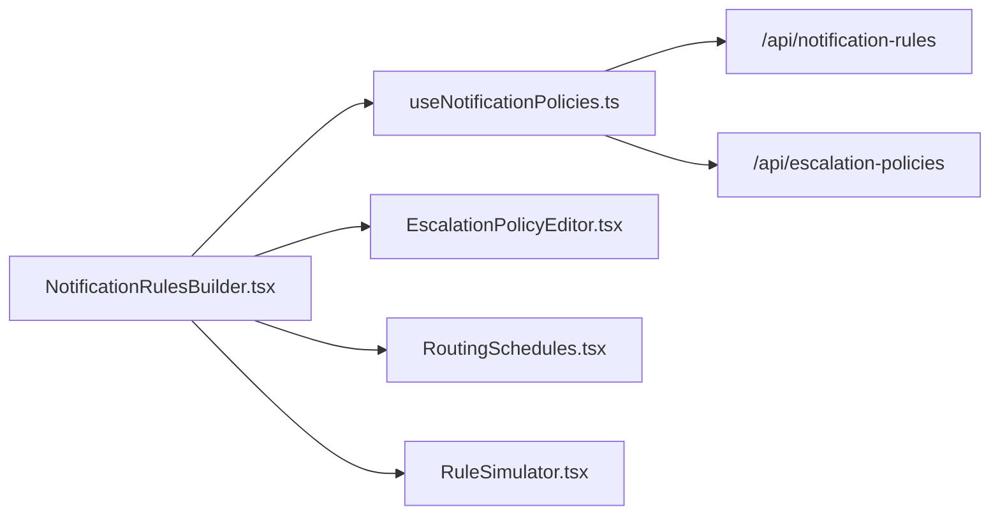

# Frontend: Notification Rules & Escalation Policy Builder (#2316)

## Overview

The **Notification Rules & Escalation Policy Builder** (`/settings/notifications/rules`) unifies multi-channel event routing (`crashes`, `regressions`, `ci_gates`, `incidents`, `data_quality`), anti-storm deduplication/throttling, on-call routing schedules, tiered escalation chains, deterministic event simulation, and versioned RBAC governance.

## Architecture

## Module Map

| Path | Purpose |
| --- | --- |
| `apps/web/src/features/notifications/rules/NotificationRulesBuilder.tsx` | WAI-ARIA tabbed shell for rule creation, predicates, templated channel targets, anti-storm rate limits, staged rollouts, approvals, and immutable audit history |
| `apps/web/src/features/notifications/rules/EscalationPolicyEditor.tsx` | Multi-tier escalation editor with per-tier timeouts, fallback recipients, and live incident acknowledgment / escalation / resolution tracking |
| `apps/web/src/features/notifications/rules/RoutingSchedules.tsx` | On-call schedule rotations, active responder resolution (`resolveActiveOnCallResponder`), quiet-hours suppression controls, temporary overrides, and maintenance windows |
| `apps/web/src/features/notifications/rules/RuleSimulator.tsx` | Interactive rule simulator testing rules against historical or sample payloads and previewing rendered messages and suppression causes |
| `apps/web/src/features/notifications/rules/hooks/useNotificationPolicies.ts` | Client data & mutation hook managing workspace-scoped rules, schedules, escalations, simulations, and RBAC transitions |
| `apps/web/src/app/api/notification-rules/route.ts` | REST endpoint (`GET`, `POST`, `PATCH`) plus pure deterministic evaluators (`evaluateRulePredicate`, `renderTemplatedPayload`, `simulateRulesAgainstEvent`, `computeRuleVersionDiff`, `normalizeThrottlingConfig`) |
| `apps/web/src/app/api/escalation-policies/route.ts` | REST endpoint (`GET`, `POST`, `PATCH`) for escalation policies, incident ack lifecycle, on-call rotations, quiet hours (`isQuietHoursActive`), and overrides |
| `apps/web/src/app/settings/notifications/rules/page.tsx` | `/settings/notifications/rules` page entrypoint |

## Functional Capabilities

1. **Predicate & Threshold Rule Builder**: Match events across `crashes`, `regressions`, `ci_gates`, `incidents`, and `data_quality` using minimum severity gates (`critical..info`) and structured attribute predicates (`eq`, `neq`, `gte`, `lte`, `contains`, `in`).
2. **Multi-Channel Templated Actions**: Route events to `in_app`, `email`, `slack`, `pagerduty`, and `webhook` targets with `{{placeholder}}` variable interpolation (`{{rule}}`, `{{severity}}`, `{{contract}}`, `{{fingerprint}}`, `{{workspace}}`).
3. **Anti-Storm Deduplication, Grouping & Throttling**: Every rule enforces bounded `dedupWindowSeconds` (`30..86400s`), `groupingKeys`, `maxDeliveriesPerHour` (`1..200/hr`), and `cooldownSeconds` (`15..86400s`) via `normalizeThrottlingConfig`.
4. **Escalation Policies & Acknowledgment Tracking**: Multi-tier escalation chains with configurable timeout windows, guaranteed fallback recipients, and incident state transitions (`triggered -> acknowledged | escalated -> resolved`).
5. **Schedule-Aware Routing & Maintenance Windows**: Weekly responder rotations, temporary overrides taking precedence over baseline shifts, UTC quiet-hours windows with optional critical-severity bypass, and source-scoped maintenance window suppression.
6. **Governance, Staged Rollout & RBAC**: Rules increment versions on every edit, record human-readable version diffs in the audit trail, support staged rollouts (`disabled`, `dry_run`, `canary_25`, `active`), and enforce maintainer RBAC for sensitive external targets (`pagerduty`, `webhook`) and policy approvals.
