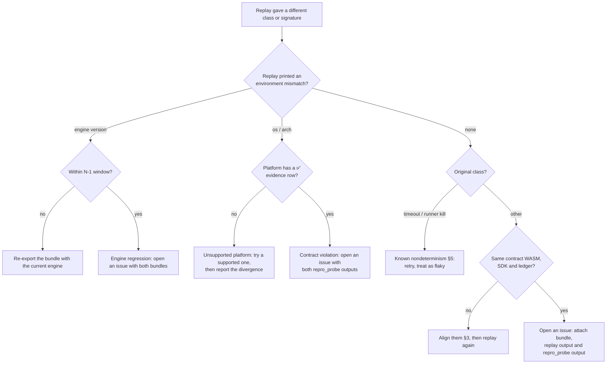

# Reproducibility contract

"The same seed reproduces anywhere" — stated precisely, with its limits and
with evidence. This is the contract; [REPRODUCIBILITY.md](REPRODUCIBILITY.md)
is the how-to and troubleshooting companion.

> File name note: this is `reproducibility-contract.md` rather than
> `reproducibility.md` because `REPRODUCIBILITY.md` already exists and the two
> would collide on case-insensitive file systems (macOS, Windows).

## 1. Definition

A failure **reproduces** when replaying its bundle yields:

1. the **same failure class** (`taxonomy.rs` `FailureClass`), and
2. the **same signature hash** (`signature_hash.rs`).

Byte-identical logs, timings or resource counters are *not* part of the
contract.

## 2. What is guaranteed

For a given **(engine version, campaign preset, seed index)**:

| Guaranteed identical everywhere in the support matrix | Code |
|---|---|
| The generated seed payload | [`prng.rs`](../contracts/crashlab-core/src/prng.rs) `SeededPrng`, `build_seed` in [`crashlab.rs`](../contracts/crashlab-core/src/bin/crashlab.rs) |
| Havoc mutations applied to it | [`havoc.rs`](../contracts/crashlab-core/src/havoc.rs) (`derive_seed_state`) |
| Failure class and signature hash | [`taxonomy.rs`](../contracts/crashlab-core/src/taxonomy.rs), [`signature_hash.rs`](../contracts/crashlab-core/src/signature_hash.rs) |
| Bundle save → load round trip preserving both | [`bundle_persist.rs`](../contracts/crashlab-core/src/bundle_persist.rs) |
| Partitioned-worker seed assignment and checkpoint resume | [`worker_partition.rs`](../contracts/crashlab-core/src/worker_partition.rs), [`checkpoint.rs`](../contracts/crashlab-core/src/checkpoint.rs) |

The probe [`examples/repro_probe.rs`](../contracts/crashlab-core/examples/repro_probe.rs)
exercises exactly this chain for a fixed seed set and folds every result into
one digest. Equal digests on two platforms are the evidence below.

### Support matrix

Platforms with a ✅ row in the evidence table are **supported**: replays
there carry the guarantee. Platforms without a row are *expected* to work (the
engine uses no floating point, no platform RNG and no hash-map iteration order
in these paths) but are **not guaranteed** until they have evidence.

## 3. Environment axes

Recorded in every bundle by [`env_fingerprint.rs`](../contracts/crashlab-core/src/env_fingerprint.rs)
and checked on replay (W5-B08):

| Axis | Must match? | Why |
|---|---|---|
| Engine version (`tool_version`) | **Within the version window** (§4) | Mutation stream and taxonomy are versioned engine behaviour |
| Contract WASM (hash) | **Yes** | A different contract is a different program |
| Soroban SDK / host version | **Yes** for host-mode replays | Host traps and metering change between releases |
| Ledger state / RPC network | **Yes** for RPC-mode replays | Results depend on on-chain state |
| OS (`os`), CPU architecture (`arch`), family | No, *within the support matrix* — flagged as "material" so a divergence is explained | Evidence shows these do not affect the guaranteed chain |
| Toolchain (rustc), worker count, machine speed, locale, time zone | No | Not inputs to the guaranteed chain |

## 4. Version window

- A bundle written by engine **N** replays with the same class and signature
  on engine **N** and **N+1** (one release back, the N-1 window). Readers keep
  N-1 bundle schemas readable (`SUPPORTED_BUNDLE_SCHEMAS` in
  [`bundle_persist.rs`](../contracts/crashlab-core/src/bundle_persist.rs)).
- A change that alters the seed stream or re-buckets signatures is a
  **breaking engine change**: it needs a version bump, a reference-digest
  update below, and an upgrade note telling users to re-baseline (W5-B02).
- Dropping an old bundle schema follows the deprecation process: announced in
  release N, removed no earlier than N+1, with a re-export path (W5-B06).
- Bundles older than the window may still replay, but without the guarantee:
  re-export them with the current engine.

## 5. Known nondeterminism (outside the contract)

| Case | Why | Workaround |
|---|---|---|
| **Timeout-class failures** | Depend on wall-clock time and host load, not only on the input. The `timeout` label's round-trip history is tracked in #1582. | Re-run with a generous timeout; treat a timeout that does not reproduce as flaky, not as a fix. |
| **Resource/wall-clock kills in the runner** | Until per-seed sandbox kills are classified deterministically (#1791), a kill can land at a different point. | Replay with the same preset budget; compare class, not counters. |
| **RPC-mode runs** | Remote ledger state changes. | Pin the ledger (snapshot) or replay in host mode. |
| **Concurrent writers to one checkpoint** | Unsupported (see REPRODUCIBILITY.md). | One writer per run directory. |
| **Float formatting in exported reports** | Display-only; never part of class/signature. | Compare signatures, not report text. |

## 6. Evidence

Produced by `cargo run --release --example repro_probe` (2,000 seeds,
`nightly` preset) per platform. The scheduled
[`reproducibility-evidence.yml`](../.github/workflows/reproducibility-evidence.yml)
workflow runs the probe on Linux, macOS and Windows and reports the digests
against the reference (report-only). Recording a run here is a reviewed change:

```bash
cargo run --release --manifest-path contracts/crashlab-core/Cargo.toml --example repro_probe > probe.json
node scripts/reproducibility/evidence.mjs record --input probe.json \
  --rustc "$(rustc --version)" --commit "$(git rev-parse --short HEAD)" --source <run-url|local>
```

CI (`check`) fails if this section is not exactly what the evidence file
renders, or if any platform's evidence is older than 45 days.

<!-- reproducibility-evidence:start -->
<!-- Generated by scripts/reproducibility/evidence.mjs render — do not edit by hand. -->

| Platform | Engine | Preset / seeds | Toolchain | Digest | Result | Recorded | Source |
|---|---|---|---|---|---|---|---|
| linux/x86_64 | 0.1.0 (bundle schema 2) | nightly / 2000 | rustc 1.95.0 | `44972c3367a6f9bd` | ✅ pass | 2026-10-16 @ `fda9f71` | local |

Reference digests: `44972c3367a6f9bd` (0.1.0, nightly, 2000 seeds).
<!-- reproducibility-evidence:end -->

**Current honest state:** evidence exists for one platform. The
macOS/Windows rows appear once the first scheduled matrix run is recorded;
until then those platforms are "expected", not "supported".

## 7. "Why did my repro fail?"


