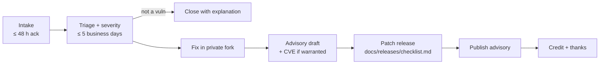

# Vulnerability disclosure: maintainer runbook

Reporter-facing policy: [`SECURITY.md`](../../SECURITY.md) (mirrored to
[`.github/SECURITY.md`](../../.github/SECURITY.md) for the Security tab).
This page is how maintainers handle a report from intake to thanks.

## 1. Intake (≤ 48 hours)

Reports arrive as GitHub private vulnerability reports (Security → Advisories)
or as a public `Security contact request` issue with no details.

- [ ] An **unconflicted** maintainer takes ownership (see
      [conflicts of interest](../../SECURITY.md#maintainer-conflicts-of-interest));
      record the owner in the advisory.
- [ ] Acknowledge in the advisory thread: thank the reporter, name the owner,
      restate the next deadline (triage within 5 business days).
- [ ] For a contact-request issue: reply asking the reporter to use the
      private form (link in `SECURITY.md`); if they cannot, give a maintainer
      email, then lock the issue. Never discuss details in it.
- [ ] Anything that looks like a live secret in the report: rotate first, ask
      questions later.

## 2. Triage and severity (≤ 5 business days)

Reproduce on `main` and on the latest release. Score with CVSS v3.1 (or v4)
in the advisory form, then map to our labels:

| Advisory severity | Typical examples here | Tracking label (after publication) | Fix target |
| --- | --- | --- | --- |
| Critical | Auth bypass on mutating routes, cross-tenant read/write, code execution from a fuzz input, bundle or uploaded artifact, signing/secret key disclosure | `severity:critical` + `security` | 14 days |
| High | Privilege escalation within a tenant (RBAC), token/session forgery with preconditions, SSRF to internal services, audit-log tampering that verification misses | `severity:critical` + `security` | 30 days |
| Medium | Information disclosure without credentials, CSRF on low-impact actions, replay within a narrow window | `severity:hard` + `security` | 60 days |
| Low | Hardening gaps with an exploit path but negligible impact | `security` | next release |

`severity:critical` / `severity:hard` are the same labels the issue backlog
uses ([legend](../contributors/where-to-start.md#labels-legend)). Private
reports have **no public issue** until the advisory is published; apply labels
to the follow-up issue created at publication.

- [ ] Set severity and affected versions in the advisory.
- [ ] Post the status update to the reporter (and every 10 business days
      after, until resolved).
- [ ] Not a vulnerability / out of scope: explain why, point to
      `SECURITY.md#scope`, close the advisory; offer a normal issue if it is a
      hardening suggestion.

## 3. Fix (target by severity)

- [ ] **Create a temporary private fork** from the advisory ("Start a
      temporary private fork") and develop the fix there — never in a public
      branch or PR.
- [ ] Add a regression test that fails without the fix.
- [ ] Invite the reporter to the private fork to verify, if they want to.
- [ ] Tell the reporter the fix or mitigation plan within **14 days** of the
      report, even if the fix itself takes longer.

## 4. Advisory draft and CVE

- [ ] Fill in: summary, affected/patched versions, impact, workarounds,
      references, credit (only if the reporter opted in, with their chosen name).
- [ ] Request a CVE from the advisory ("Request CVE") for anything Medium or
      above that affects a released version. GitHub is the CNA; no separate
      process is needed.

## 5. Release

- [ ] Merge the private fork into `main` from the advisory, then cut a patch
      release for every supported line per
      [`docs/releases/checklist.md`](../releases/checklist.md). The release
      notes link the advisory ID.
- [ ] Publish the advisory **after** the release is available — same day.
- [ ] Agree the publish date with the reporter; never later than 90 days from
      the report unless they agree to extend.

## 6. Credit and thanks

- [ ] Credit the reporter in the advisory and release notes if they opted in.
- [ ] Thank them in the advisory thread with the published links.
- [ ] Open a public follow-up issue (labels per the table above) for any
      hardening work the fix did not cover.

## Repository settings checklist

These are **maintainer actions** in the repository settings. Contributors
cannot do them, and the disclosure policy issue (#1902) closes only once each
box is confirmed — paste a screenshot or `gh api` output as evidence on the
issue.

- [x] **Private vulnerability reporting enabled** — Settings → Code security →
      Private vulnerability reporting → Enable. Verify:
      `gh api repos/SorobanCrashLab/soroban-crashlab/private-vulnerability-reporting`
      returns `{"enabled": true}` (confirmed 2026-10-16).
- [ ] **Security advisories** — at least two unconflicted maintainers have
      admin or security-manager access so a report never waits on one person.
- [ ] **Notifications** — those maintainers watch the repository with
      "Security alerts" enabled.
- [ ] **Dependabot alerts and security updates** — enabled.
- [ ] **Secret scanning and push protection** — enabled.
- [ ] **Fallback email** — a maintainer-monitored address is agreed for
      reporters who cannot use GitHub's form (handed out privately, per
      `SECURITY.md`).
- [ ] **Issue chooser** — `.github/ISSUE_TEMPLATE/config.yml` links to the
      private form (done in the PR for #1902).
