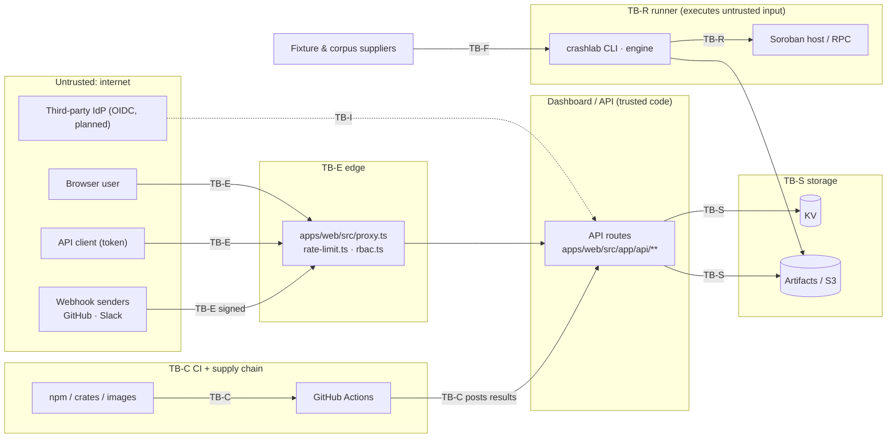

# Threat model v2: RBAC, artifacts, tenancy and campaign inputs

- **Status:** Draft for review — needs a second engineer's ADR-quality review
  before it is marked Accepted (AGENTS.md security discipline).
- **Issue:** #1897. Supersedes the system-level parts of
  [THREAT_MODEL_ARTIFACT_HANDLING.md](../THREAT_MODEL_ARTIFACT_HANDLING.md)
  (v1, artifact handling), which stays the detailed reference for T-1…T-11.
- **Traceability gate:** `node scripts/check-threat-model.mjs` (CI:
  `threat-model.yml`) checks that every abuse case cites at least one existing
  test file or an issue, that every cited file exists, and that every cited
  issue resolves on GitHub.

## 1. Scope and assets

In scope: the Rust engine and CLI (`contracts/crashlab-core`), the Next.js
dashboard and API (`apps/web`), CI workflows (`.github/workflows`), the
reference deployment (`deploy/`), and the storage they use (KV, object
storage, local state directories).

| Asset | Why it matters | Where it lives |
|---|---|---|
| A1 Crash findings (runs, bundles, signatures, fixtures) | The product's output; integrity = trust in every report | KV (`runs:*`), artifact dir / S3, `contracts/crashlab-core/fixtures/` |
| A2 Credentials: API tokens, session secrets, webhook secrets, RPC keys | Direct account takeover / impersonation | KV (hashed tokens), env / Docker secrets |
| A3 Role assignments and audit trail | Who may do what, and proof of who did | KV (`rbac:*`), audit log |
| A4 Tenant separation (orgs/projects) | Customer data isolation | Planned — #1894 |
| A5 Campaign inputs (seeds, corpora, contract WASM, fixtures) | Executed by the engine; attacker-controlled by design | CLI inputs, imports, uploads |
| A6 Build and release pipeline | Every user runs what CI produces | `.github/workflows`, images |
| A7 Availability of campaigns and dashboard | Nightly evidence, CI gates downstream | Runners, web, storage |

## 2. Trust boundaries

| Boundary | Crossed by | Trust decision |
|---|---|---|
| **TB-E** internet → edge | Every HTTP request | Identity from API token, signed session cookie, or webhook signature — never from a header the caller sets (`rbac.ts`) |
| **TB-I** IdP → app | OIDC tokens (planned) | Issuer pinned, signature/aud/nonce validated (#1893) |
| **TB-S** app → storage | KV/S3 reads and writes | Storage trusts the app; the app must scope every key (#1894) |
| **TB-F** supplier → engine | Seeds, corpora, fixtures, bundles | Schema-validated, size-bounded, never executed as code |
| **TB-R** engine → host/RPC | Contract execution | Untrusted WASM and payloads run inside the host's metering; RPC credentials redacted |
| **TB-C** dependencies → CI → release | Packages, actions, images, CI posts | Actions pinned by SHA; tokens least-privilege; releases signed (#1816) |

## 3. Attacker profiles

| ID | Profile | Capabilities | Goals |
|---|---|---|---|
| P1 | External attacker | Any HTTP request; stolen/guessed tokens; replayed captures | Takeover, data theft, defacement of findings |
| P2 | Malicious tenant member (analyst) | Valid low-privilege identity | Escalate to maintainer, read/modify another tenant's data, hide own actions |
| P3 | Malicious fixture / corpus supplier | Crafted seeds, bundles, archives, WASM | Code execution in runner or CI, path traversal, poisoning results |
| P4 | Compromised dependency or action | Code running in build/CI/runtime | Secret exfiltration, backdoored release |
| P5 | Compromised third party | Rogue webhook sender, IdP misconfiguration, RPC endpoint | Forged events, identity confusion, credential capture |
| P6 | Careless operator | Misconfiguration (HTTP in prod, shared secrets) | — (accidental exposure) |

## 4. Entry points

| Entry point | Code | Authn | Notes |
|---|---|---|---|
| Dashboard API (≈70 route handlers across `runs`, `artifacts`, `settings`, `webhooks`, `integrations`, `campaigns`, `schedules`, `networks`, `notifications`, `health`, `openapi`, `sentry`, `database`, `auth`) | `apps/web/src/app/api/**/route.ts` | Token / session; mutating routes need a role ([rbac.ts](../../apps/web/src/lib/rbac.ts) `ROUTE_ROLE_RULES`) | GET routes are not role-gated today — #1817 |
| GitHub OAuth login/callback | [`api/auth/github`](../../apps/web/src/app/api/auth/github/) | OAuth state cookie | Code exchange still stubbed |
| Inbound webhooks: GitHub, Slack interactivity | [`github-webhook-verify.ts`](../../apps/web/src/lib/github-webhook-verify.ts), [`slack-signature.ts`](../../apps/web/src/lib/integrations/slack-signature.ts) | HMAC signatures | Replay window — #1813 |
| Artifact uploads | [`api/artifacts`](../../apps/web/src/app/api/artifacts/), [`api/uploadthing`](../../apps/web/src/app/api/uploadthing/) | Role-gated POST | Validation in [`upload-validation.ts`](../../apps/web/src/lib/upload-validation.ts) |
| CLI: `crashlab run start`, `replay seed`, `import-corpus`, `check-fixtures`, `lint-fixtures` | [`src/bin/`](../../contracts/crashlab-core/src/bin/) | Local user | Inputs are attacker-controlled (P3) |
| Corpus / fixture imports | [`corpus_import.rs`](../../contracts/crashlab-core/src/corpus_import.rs), [`fixture_compat.rs`](../../contracts/crashlab-core/src/fixture_compat.rs) | — | Schema + bounds validation |
| CI posts results back (regression, nightly) | [`.github/workflows/`](../../.github/workflows/) | `GITHUB_TOKEN` | Scope of CI tokens — #1890 |
| Operator configuration | env / Docker secrets ([ENV.md](../ENV.md)) | Host access | Out of scope beyond P6 guidance (#1896) |

## 5. Abuse cases

Status: **M** mitigated (test cited), **P** partial, **O** open (issue cited).
Every row is a control in this model; the issue batch is the control backlog.

| ID | Boundary | Profile | Abuse case | Mitigation | Status | Evidence |
|---|---|---|---|---|---|---|
| AC-01 | TB-E | P2 | Analyst sends `x-crashlab-role: maintainer` (or query/cookie/body role) to self-promote | Roles resolve only from the persisted role store keyed by a verified principal | M | `apps/web/src/lib/rbac.test.ts`, `apps/web/src/lib/rbac.integration.test.ts` |
| AC-02 | TB-E | P1 | Replay a stolen or revoked API token | Tokens stored hashed, revocation honoured, expiry + rotation overlap; lifecycle audit pending | P | `apps/web/src/lib/storage/api-token-store.test.ts`, `apps/web/src/lib/api-key-auth.test.ts`, #1804 |
| AC-03 | TB-E | P1 | Forge or replay a revoked session cookie to impersonate a browser identity | HMAC-signed opaque ID backed by shared Redis state; login rotation, server-side logout invalidation, 30-minute idle / 12-hour absolute expiry; fail closed without durable storage | M | `apps/web/src/lib/github-session.test.ts`, `apps/web/src/app/api/auth/logout/route.test.ts`, #1807 |
| AC-04 | TB-E | P1 | Login CSRF / OAuth state fixation, open redirect after login | Single-use state cookie today; HMAC-bound state and redirect allowlist pending | P | #1805, #1806 |
| AC-05 | TB-E | P1 | Cross-site request triggers a state-changing route from a logged-in browser | SameSite cookies only; central CSRF defense pending | O | #1808 |
| AC-06 | TB-E | P5 | Replay a captured, validly signed webhook (GitHub/Slack) | HMAC verification with constant-time compare; timestamp window + nonce cache pending | P | `apps/web/src/lib/github-webhook-verify.test.ts`, `apps/web/src/lib/webhook-hmac.test.ts`, #1813 |
| AC-07 | TB-S | P2 | Tenant member reads or writes another org's runs/artifacts by guessing ids (IDOR, tenant hopping) | Org/project scope enforced in the repository layer, random ids, audited denials | O | #1894 |
| AC-08 | TB-E | P2 | Read-only routes leak data to callers without the capability | Deny-by-default capability registry for every route | O | #1817, #1880 |
| AC-09 | TB-F | P3 | Artifact poisoning: zip-slip, decompression bomb, MIME confusion in uploads | Upload type/size validation; archive extraction caps pending | P | `apps/web/src/lib/upload-validation.test.ts`, `apps/web/src/lib/request-size-limits.test.ts`, #1811 |
| AC-10 | TB-F | P3 | Path traversal through seed payloads used in artifact names | Filenames from signature hashes only; store rejects separators | M | `contracts/crashlab-core/src/threat_model_tests.rs` (T-1), `contracts/crashlab-core/src/artifact_storage.rs` |
| AC-11 | TB-F | P3 | Oversized or malformed seeds/bundles exhaust memory or confuse readers | `SeedSchema` bounds, bundle schema version checks | M | `contracts/crashlab-core/src/threat_model_tests.rs` (T-2, T-3, T-4) |
| AC-12 | TB-F | P3 | Fixture backdoor: a contributed fixture or exported Rust regression test injects code or hides a crash | Hex-encoded payloads and validated test names in exported fixtures; provenance manifest pending | P | `contracts/crashlab-core/src/threat_model_tests.rs` (T-9), #1864 |
| AC-13 | TB-F | P3 | Seed payloads, XDR or imports reach a shell, filesystem path or `eval` sink | Sink audit across engine and web | O | #1818 |
| AC-14 | TB-R | P3 | Malicious contract/seed wedges a runner (CPU, memory, wall-clock) | Mutation budget + retention caps; per-seed resource sandbox pending | P | `contracts/crashlab-core/src/threat_model_tests.rs` (T-10), #1791 |
| AC-15 | TB-R | P5 | RPC credentials leak into logs, envelopes or exported reports | Auth parameter redaction; secret sanitization on export | M | `contracts/crashlab-core/src/threat_model_tests.rs` (T-5, T-6) |
| AC-16 | TB-E | P1 | SSRF: user-configured integration URLs (webhooks, Grafana, Prometheus) reach internal services | Scheme/host/IP policy on all outbound fetches | O | #1809 |
| AC-17 | TB-I | P5 | OIDC flaws: unpinned issuer, alg confusion, missing aud/nonce checks, default-admin mapping | Hardened OIDC flow with explicit role mapping | O | #1893 |
| AC-18 | TB-C | P4 | CI token abuse: a PR or compromised action uses `GITHUB_TOKEN` to post forged results or write to the repo | Actions pinned by SHA, minimal `permissions:`; CI result posting scoped | P | `.github/workflows/action-pins.yml`, `.github/workflows/semantic-pr.yml`, #1890 |
| AC-19 | TB-C | P4 | Backdoored dependency or unsigned image shipped in a release | SBOM, image signing and provenance; deterministic build | O | #1816, #1828 |
| AC-20 | TB-S | P2 | Insider deletes or edits audit entries to hide actions | Hash-chained append-only audit log with verification; signed checkpoints + query surface pending | P | `apps/web/src/lib/audit/audit-log.test.ts`, #1895 |
| AC-21 | TB-S | P1 | Secrets at rest in KV readable by anyone with storage access | Token hashes only; envelope encryption of stored secrets pending | P | `apps/web/src/lib/storage/api-token-store.test.ts`, #1803 |
| AC-22 | TB-E | P1 | Credential stuffing / brute force against token and login endpoints | Per-IP rate limiting; per-principal buckets pending | P | `apps/web/src/rate-limit.test.ts`, #1810 |
| AC-23 | TB-S | P1 | Secrets or PII in logs, traces and stored artifacts | Redaction in audit metadata and exports; pipeline-wide redaction pending | P | `apps/web/src/lib/sanitize.test.ts`, #1812 |
| AC-24 | TB-E | P6 | Self-hoster serves the dashboard over plain HTTP or with default secrets | Reference deployment with TLS edge, generated secrets, non-root services | O | #1896 |

## 6. STRIDE per component

| Component | S | T | R | I | D | E | Residual risk |
|---|---|---|---|---|---|---|---|
| Edge (`proxy.ts`, `rate-limit.ts`, `rbac.ts`) | AC-01–03 | — | AC-20 | AC-08 | AC-22 | AC-01 | Medium: GET routes are not capability-gated until #1817; CSRF relies on SameSite until #1808. |
| API routes | AC-04 | AC-05 | AC-20 | AC-07, AC-16 | AC-09 | AC-08 | High until tenancy (#1894) lands for multi-team deployments; single-tenant deployments are Medium. |
| Webhook ingress | AC-06 | AC-06 | — | — | AC-22 | — | Medium: signed but replayable within the sender's retry window until #1813. |
| Storage (KV, S3, artifact dir) | — | AC-20 | AC-20 | AC-21, AC-07 | — | — | Medium: anyone with storage credentials sees token hashes and run data; at-rest encryption is the operator's (#1803, #1896). |
| Engine / CLI | — | AC-12 | — | AC-15 | AC-11, AC-14 | AC-13 | Medium: a wall-clock wedge is still possible without the sandbox (#1791); symlink races (v1 T-7) remain documented residual risk. |
| Runner ↔ host/RPC | AC-17 | — | — | AC-15 | AC-14 | — | Low for host mode; RPC endpoints are trusted for availability only. |
| CI / release | AC-18 | AC-19 | — | AC-18 | — | AC-18 | Medium: no signed releases or SBOM yet (#1816). |
| Deployment | AC-24 | — | — | AC-24 | — | — | Operator-dependent; mitigated only for deployments that follow #1896. |

## 7. Non-goals (stated honestly)

- **Repository admins and maintainers with merge rights.** They can change
  any control here. We rely on review, CODEOWNERS and the conflict-of-interest
  policy in `.github/SECURITY.md`, not on technical prevention.
- **The host/hypervisor and the operator's cloud account.** A compromised host
  sees every secret and all data.
- **Contracts under test.** Finding their bugs is the product; they are not
  our vulnerabilities.
- **Volumetric DoS.** Left to the hosting provider / CDN; we only bound
  per-request cost.
- **Malicious browser extensions or a compromised end-user device.**

## 8. Code-side tests → model

[`threat_model_tests.rs`](../../contracts/crashlab-core/src/threat_model_tests.rs)
is organised by the v1 threats; this is where each section lands in v2.

| `threat_model_tests.rs` section | v1 threat | v2 abuse case |
|---|---|---|
| `t1_*` | T-1 path traversal | AC-10 |
| `t2_*` | T-2 memory exhaustion | AC-11 |
| `t3_*` | T-3 null bytes | AC-11 |
| `t4_*` | T-4 schema version | AC-11 |
| `t5_*` | T-5 RPC credential redaction | AC-15 |
| `t6_*` | T-6 secret sanitization | AC-15 |
| `t7_*` | T-7 symlink attack (residual, documented) | AC-10 residual |
| `t8_*` | T-8 checkpoint concurrency | AC-14 (integrity under concurrency) |
| `t9_*` | T-9 Rust fixture injection | AC-12 |
| `t10_*` | T-10 storage exhaustion | AC-14 |

## 9. Maintaining this model

- A PR that adds an entry point, a trust boundary, or a security control
  updates the tables above in the same PR.
- When an issue cited as **O**/**P** lands, replace or add the test file that
  proves it and update the status; the check script keeps the citations real.
- Review cadence: with every minor release (see
  [release policy](../RELEASE_PROCESS.md)) and after every security incident.
