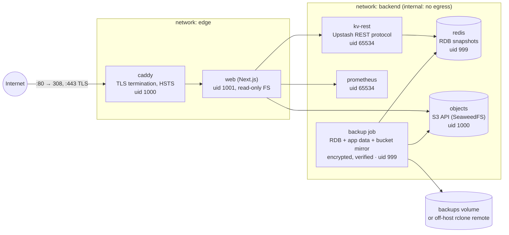

# Reference deployment (self-hosting)

A hardened, single-host Docker Compose topology for running CrashLab yourself:
TLS at the edge, non-root services, secrets kept out of images and git,
scheduled and *verified* backups, a restore you have actually run, and an
upgrade procedure with a rollback. Files: [`deploy/compose/`](../../deploy/compose/)
and [`deploy/backup/`](../../deploy/backup/) (#1896).

## Topology



| Service | Image (pinned by digest) | Notes |
|---|---|---|
| `caddy` | `caddy:2.10-alpine` | Only service with published ports. Blocks `/api/health/metrics` from the internet. |
| `web` | your verified release image, or built from `apps/web/Dockerfile` | Secrets arrive from `/run/secrets` via `load-secrets.sh`; data volume at `/data` (artifacts, SQLite). |
| `redis` | `redis:7.4-alpine` | Password from a secret written to a tmpfs include file (never on the command line). `CONFIG`, `DEBUG`, `MODULE` disabled. |
| `kv-rest` | `hiett/serverless-redis-http` | The app's KV client speaks the Upstash REST protocol; this adapts it to Redis. |
| `objects` | `chrislusf/seaweedfs:3.85` | S3-compatible store. MinIO no longer publishes community images; any S3 endpoint can replace it. |
| `prometheus` | `prom/prometheus:v3.5.0` | Monitoring hookup (below). Internal only. |
| `backup` | built from `deploy/backup/Dockerfile.compose` (Redis tools + pinned rclone) | Runs `compose-backup.sh` every `BACKUP_INTERVAL_SECONDS`; healthy only while the last *verified* backup is fresh. |

Every long-running service: non-root user, `cap_drop: [ALL]` (Caddy keeps
only `NET_BIND_SERVICE`), `no-new-privileges` (except Caddy, whose bind
capability is a file capability), read-only root filesystem with tmpfs for
scratch (except `kv-rest`, whose runtime writes next to itself), healthcheck,
`restart: unless-stopped`, CPU/memory limits, rotated JSON logs (5×10 MB).

## Install

```bash
cd deploy/compose
cp .env.example .env && chmod 600 .env      # set CRASHLAB_DOMAIN, NEXT_PUBLIC_APP_URL
./generate-secrets.sh                        # creates secrets/ (0700), one file per secret
docker compose up -d --wait
```

### Verify the image (W5-C14)

Run a released, signed image rather than building on the server. Once
releases are signed (#1816, #1901), verify and pin by digest:

```bash
cosign verify ghcr.io/sorobancrashlab/soroban-crashlab-web:vX.Y.Z \
  --certificate-identity-regexp 'https://github.com/SorobanCrashLab/soroban-crashlab/.github/workflows/release.yml@refs/tags/v.*' \
  --certificate-oidc-issuer https://token.actions.githubusercontent.com
# then in .env:
CRASHLAB_WEB_IMAGE=ghcr.io/sorobancrashlab/soroban-crashlab-web@sha256:<digest>
```

Until signed images are published, `docker compose build web` builds from
the checked-out source (`apps/web/Dockerfile`, target `runner`). If the build
cannot reach Google Fonts from inside the build container, add
`--network host` (`docker build --network host …`).

### Secrets

- `secrets/` holds one file per secret, generated with `openssl rand`. The
  directory is `0700` so other host users cannot read it; files are `0644`
  inside it so each container's non-root user can read its bind mount.
- A service sees only the secrets listed under it in `compose.yml`.
- `.env` holds configuration only (domain, ports, intervals) and is `0600`.
  Neither `.env` nor `secrets/` is ever committed (`.gitignore`) or baked into
  an image.
- `SECRETS_MASTER_KEY` is the master key for envelope encryption of stored
  secrets (W5-C01, #1803). Generate it once — `openssl rand -base64 32` —
  and keep a copy **off this host** (password manager / KMS). Losing it makes
  anything encrypted with it unrecoverable. Same for `BACKUP_ENCRYPTION_KEY`.
- Rotate a secret: replace its file, then `docker compose up -d --force-recreate <services>`.

## TLS

`CRASHLAB_TLS_MODE` in `.env`:

| Mode | Use | Requirements |
|---|---|---|
| `auto` (default) | Production | Public DNS for `CRASHLAB_DOMAIN` pointing at the host; ports 80/443 reachable for ACME |
| `files` | Your own CA / corporate certs | `cert.pem` + `key.pem` in `CRASHLAB_TLS_CERT_DIR` (default `./certs`, git-ignored) |
| `internal` | LAN / evaluation | Clients must trust Caddy's local root (`docker compose cp caddy:/data/caddy/pki/authorities/local/root.crt .`) |

HTTP redirects to HTTPS (308) and responses carry HSTS (1 year).

**What TLS covers:** confidentiality and integrity between clients and Caddy,
and server authentication (the browser knows it reached your domain).

**What it does not cover:** traffic between Caddy and the services (plain HTTP
on the private Docker networks — anyone with root on the host can read it);
data at rest (volumes are unencrypted — use disk encryption); authentication of
*users* (that is the app's tokens/sessions); and a compromised host. Treat the
host as the trust boundary.

## Monitoring hookup (W5-I02)

- **Liveness:** `GET /api/health/liveness` — used by the healthchecks and by
  Caddy's active health checks. Point external uptime monitoring at it through
  the TLS edge.
- **Dependencies:** `GET /api/health` reports database, Prometheus and
  integration status (`healthy` / `degraded` / `unhealthy`, HTTP 503 when unhealthy).
- **Prometheus:** the stack's Prometheus is what `/api/health` checks.
  Add scrape jobs for the app to [`prometheus.yml`](../../deploy/compose/prometheus.yml)
  as metrics endpoints land (#1888); they authenticate with
  `CRASHLAB_METRICS_SCRAPE_TOKEN` and are unreachable from the internet
  (Caddy returns 404 for `/api/health/metrics`). To reach Prometheus from
  your workstation: `ssh -L 9090:<prometheus container IP>:9090 host`, or
  attach your own monitoring stack to the `backend` network.
- **Backups:** the `backup` container is unhealthy when the last verified
  backup is older than 1.5 intervals — alert on `docker compose ps` health.

## Backups

Every `BACKUP_INTERVAL_SECONDS` (default daily) the `backup` service runs
[`compose-backup.sh`](../../deploy/backup/compose-backup.sh):

1. Redis point-in-time dump with `redis-cli --rdb`, validated with `redis-check-rdb`.
2. Tarball of the app data volume (artifacts + SQLite).
3. Manifest of the S3 bucket and an incremental mirror of it (objects changed
   or deleted by a run are kept under `objects/history/<snapshot>`).
4. Everything encrypted client-side (rclone crypt, `BACKUP_ENCRYPTION_KEY`).
5. **Verification:** the snapshot is read back, decrypted, checksummed against
   its manifest, the RDB re-validated, the archive listed, and the mirror
   compared with the live bucket (`rclone cryptcheck`). Only then is
   `last-success.json` updated.
6. Snapshots and history older than `BACKUP_RETENTION_DAYS` are deleted.

Run one now: `docker compose exec backup /opt/crashlab/load-secrets.sh /opt/backup/compose-backup.sh`.

**Keep backups off the host.** The default target is the local `backups`
volume, which does not survive losing the host. Set `BACKUP_TARGET` to an
rclone remote (e.g. `offsite:crashlab-backups`) and configure it with
`RCLONE_CONFIG_OFFSITE_*` variables in `.env`, using credentials that cannot
delete from the source. The full backup design (retention tiers, RPO/RTO,
nightly restore verification) is the W5-J04 runbook (#1900).

Consistency notes: the RDB dump is point-in-time; the app-data tarball and the
bucket mirror are taken seconds apart, and the SQLite file is copied while the
app runs. For a strictly consistent snapshot, `docker compose stop web` first.

## Restore

```bash
cd deploy/compose
docker compose stop web kv-rest redis backup
docker compose --profile restore run --rm restore latest   # or a snapshot name
docker compose up -d --wait
```

[`compose-restore.sh`](../../deploy/backup/compose-restore.sh) downloads and
decrypts the snapshot, checks every file against its manifest and validates
the RDB **before** writing anything, then replaces `dump.rdb`, the app data
volume and the bucket contents, and checks the bucket against the manifest.
Its output names the snapshot it restored.

### Drill record

[`deploy/compose/drill.sh`](../../deploy/compose/drill.sh) boots the stack on
high ports with `CRASHLAB_TLS_MODE=internal`, checks TLS and health, writes
data through the app, backs up, deletes the Redis, app-data and object
volumes, restores, and checks the data came back.

| Date | Result | Evidence |
|---|---|---|
| 2026-10-16 | ✅ passed | All 7 services healthy; `https://crashlab.localhost:18443/api/health/liveness` → 200 with TLS verified against Caddy's local CA; HTTP → 308; `/api/health/metrics` → 404 at the edge; HSTS + nosniff present; `/api/health` overall `healthy` (database ok, metrics ok). Hardening confirmed per container (users 1000/1001/999/65534, read-only root FS except kv-rest, `CapDrop=[ALL]`, memory limits, `unless-stopped`). Backup + verification 10 s (3 Redis keys, 2 app-data files, 1 object). After deleting the three data volumes: restore + reboot 130 s; the seeded run is returned by `/api/runs`, the artifact directory digest matches (`0e1332b11141d74c`), the bucket object is back, liveness 200. |

Re-run the drill after changing anything in `deploy/` and add a row.

## Upgrade runbook

Database migrations run automatically when `web` boots and are forward-only,
so the rollback path is "previous image + pre-upgrade backup".

1. Read the release notes (and upgrade note, if any) for the target version,
   especially breaking changes.
2. Take and verify a backup:
   `docker compose exec backup /opt/crashlab/load-secrets.sh /opt/backup/compose-backup.sh`.
   Note the snapshot name it prints.
3. Verify the new image (above) and set `CRASHLAB_WEB_IMAGE` to its digest.
   Keep the old digest.
4. `docker compose pull web && docker compose up -d --wait web`
   (boot migrations run here).
5. Health-verify: `curl -fsS https://$CRASHLAB_DOMAIN/api/health/liveness`,
   then `/api/health` shows no `unavailable` dependency; open a few runs.
6. **Rollback** if step 5 fails: set `CRASHLAB_WEB_IMAGE` back to the old
   digest, stop `web kv-rest redis backup`, run the restore with the snapshot
   from step 2, `docker compose up -d --wait`.

Infrastructure images (Redis, SeaweedFS, Caddy, Prometheus) are pinned by
digest in `compose.yml`; bump them in a reviewed change and re-run the drill.

## Known gaps

- With KV configured, `GET /api/artifacts` lists the KV artifact index while
  `POST /api/artifacts` writes to `CRASHLAB_ARTIFACT_DIR`, so uploaded files
  do not appear in the list. The files are stored and backed up; the API
  inconsistency is an application issue, not a deployment one.
- The S3 storage driver is configured (`CRASHLAB_STORAGE_DRIVER=s3`) but the
  artifact routes still use the filesystem repository; both are backed up.
- `kv-rest` cannot run with a read-only root filesystem.
